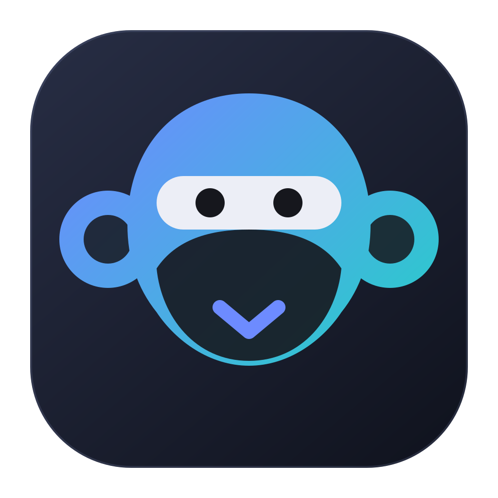
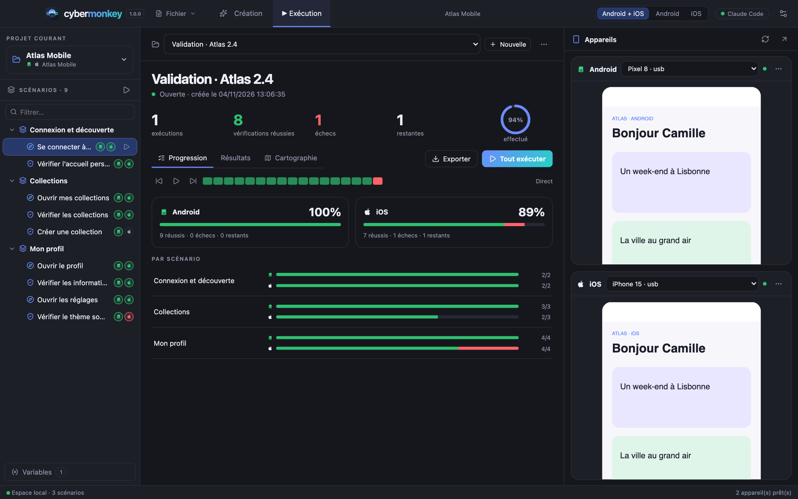
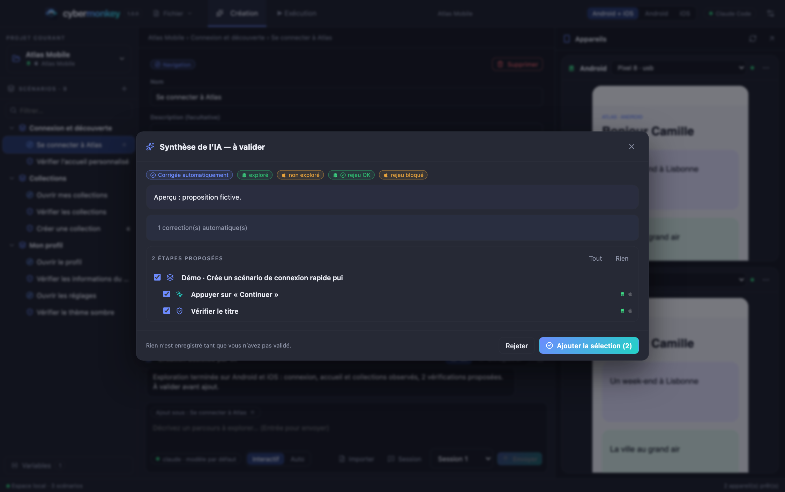
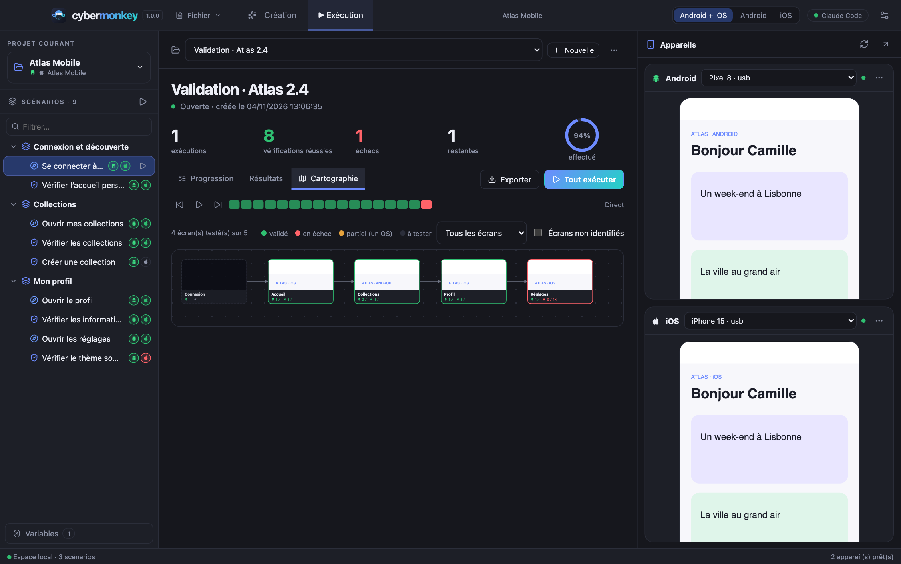

<div align="center">
  
  <h1>Cybermonkey</h1>
  <p><strong>Vos tests mobiles, preuves à l’appui.</strong></p>
  <p>Espace de travail open source pour créer, enregistrer et rejouer des scénarios Android &amp; iOS — avec l’IA.</p>
  <p><strong>Français</strong> · <a href="README.md">English</a></p>
  <p><a href="https://pickywawa.github.io/cybermonkey/">Site</a> · <a href="https://github.com/pickywawa/cybermonkey/releases/latest">Télécharger</a> · <a href="https://pickywawa.github.io/cybermonkey/fonctionnement.html">Fonctionnement</a> · <a href="https://pickywawa.github.io/cybermonkey/fonctionnalites.html">Fonctionnalités</a> · <a href="https://pickywawa.github.io/cybermonkey/aide.html">Aide</a> · <a href="CHANGELOG.md">Nouveautés</a></p>
</div>



_Captures avec données de démonstration (application fictive « Atlas Mobile »)._

Cybermonkey succède à Cyberfox, reconstruit sur une architecture plus claire (voir [docs/architecture.md](docs/architecture.md)).

## Ce que vous pouvez faire

- **Créer** : décrire un parcours (Claude Code, Codex ou GitHub Copilot explorent vos appareils, puis une **synthèse** est à valider avant toute écriture) ; **enregistrer en naviguant sur le téléphone** ; **construire à la main** en cliquant les composants du miroir ; **importer des cas de test** (Squash TM, TestRail, Azure Test Plans, Gherkin, CSV, JSON, Markdown) et les faire automatiser par l’IA.
- **Exécuter** : campagnes avec résultats par OS, **lancement sans fenêtre pour la CI/CD** (code de sortie, JUnit, installation du build), captures à chaque étape, **réparation automatique des sélecteurs** (jamais sur les vérifications), **analyse structurée** des échecs, préparation de l’écran de départ. Travaillez sur **Android + iOS ou un seul OS à la fois** ; une étape propre à un OS est « non applicable » sur l’autre, un trou n’est jamais un échec.
- **Comprendre** : avancement par OS et par scénario, **cartographie** des écrans prévus et testés avec résultats Android/iOS, exports **texte, CSV, Markdown, Confluence, HTML, JUnit, JSON**.
- **Configurer sans douleur** : diagnostic détaillé de chaque appareil (cause + correctif + commande à copier), diagnostic par l’IA, erreurs expliquées.
- Fenêtres **Appareils** et **IA** détachables, détection automatique des appareils, détection de l’application à tester, mises à jour automatiques, 7 thèmes, français et anglais, variables de projet (créées à la volée par l’IA).

## Conçu pour durer

Un test mobile échoue pour mille raisons qui ne sont pas des bugs. Cybermonkey est fait pour qu'**un échec veuille dire quelque chose**.

- **Pas riches** : appui, **appui long**, **double appui**, glisser, **défiler jusqu'à ce qu'un composant soit visible**, lancer / relancer / fermer / mettre en arrière-plan l'app, **liens profonds**, **réponse aux dialogues système**, orientation, clavier, **capture d'un texte dans une variable**. Vérifications : visible, absent, texte, contenant, actif, sélectionné, **expression régulière**, **nombre de composants**.
- **Logique de scénario** : **conditions** (« si la bannière cookies est visible, la fermer » ; ignoré, pas échoué, sinon), **appel de sous-scénario** (« Se connecter » écrit une fois), **jeux de données** (un passage par ligne, colonnes = variables), **capture de valeur** réutilisée plus loin.
- **Environnements** : recette, préprod… chacun avec ses variables qui remplacent les variables communes ; un sélecteur change la création, l'exécution et MCP.
- **Imprévus** : popups, toasts, message « session expirée », écran de connexion après une déconnexion, permissions, plantages. Quand un pas échoue : l'app disparue est relancée, les dialogues système sont répondus (jamais un bouton qui supprime, déconnecte ou paie), vos **gestionnaires d'imprévus** (scénarios ordinaires déclenchés par ce qui est à l'écran, enchaînables, capables de se reconnecter puis de **revenir là où le test en était**) s'exécutent, et en dernier recours l'IA ferme une popup inattendue. Tout est tracé dans le rapport.
- **Fiabilité** : **relance ciblée** (un pas réussi seulement au 2e essai est **instable**, pas masqué), protection contre l'appui perdu après un relancement, **historique de stabilité** (« passé 8 fois sur 10 » : régression ou test fragile ?), **audit de durabilité des sélecteurs** avec l'identifiant à demander aux développeurs, **réparations IA** appliquées aux scénarios en un clic.
- **Diagnostic** : **vidéo** des seuls scénarios en échec, **journal de l'appareil** autour de l'échec, **détection de problèmes réseau** (hors ligne, délai, TLS, 5xx, 401/403), **comparaison visuelle** avec la dernière réussite (zones modifiées entourées).
- **Vitesse** : Android et iOS pilotés **en parallèle**, attentes sur condition, **raccourci par lien profond** vers un écran de départ, **profil de durée** par pas (agir vs. relever des preuves).

Détails : [Fonctionnalités](https://pickywawa.github.io/cybermonkey/fonctionnalites.html).

## Serveur MCP

Cybermonkey embarque un **serveur MCP** de **45 outils** (activé par défaut, local, protégé par un jeton, désactivable en entier dans _Réglages → MCP_ ; chaque outil se coche/décoche dans son groupe). Une IA appelante peut lister les scénarios, trouver le chemin pour atteindre une étape, déplacer l’application sur un écran, rejouer n’importe quel élément dans n’importe quel ordre, lire des résultats structurés (étape en échec, capture, analyse), explorer et cliquer sur les appareils, et créer puis vérifier de nouveaux scénarios, sur les deux OS à la fois. Voir [docs/mcp.md](docs/mcp.md).

```sh
claude mcp add --transport http cybermonkey http://127.0.0.1:4750/mcp --header "Authorization: Bearer <jeton>"
```

## Ligne de commande et CI/CD

Cybermonkey lance une campagne **sans fenêtre** et rend un **code de sortie** que votre pipeline comprend (Jenkins, GitHub Actions, GitLab CI…). La CI construit l’app, puis demande à une **machine de test** (un Mac ou un PC avec des appareils ou des émulateurs, déclaré comme agent/runner auto-hébergé) de l’installer et de jouer la campagne : un runner CI jetable n’a pas de téléphone, le moteur tourne donc là où sont les appareils.

```sh
/Applications/Cybermonkey.app/Contents/MacOS/Cybermonkey --cli run \
  --project "Atlas Mobile" --env recette \
  --android-app app-debug.apk --fresh --out reports
```

- **Installe le build** (`.apk`, `.app` simulateur, `.ipa` iPhone), avec désinstallation préalable pour un départ à blanc (`--fresh`).
- **Codes de sortie** qui distinguent _l’app est cassée_ (`1`) de _la machine est cassée_ (`2`) : un appareil absent ou une exécution qui n’a rien joué n’est jamais verte. `3` = délai dépassé ou interruption.
- **Rapports** `junit.xml`, `html.html`, `json.json` (ou tout autre format d’export), plus captures et vidéos avec `--artifacts`.
- Mêmes projets, appareils associés, environnements (`--env`, pour l’exécution seulement) et gestion des imprévus que l’application.

Exemples Jenkins, GitHub Actions et GitLab, toutes les options et ce que la commande ne fait pas encore : [docs/cli.md](docs/cli.md).

## Intégrations : Git, notifications, outils de test, tickets

_Réglages → Intégrations._ Tout est facultatif et désactivé par défaut. Ces fonctions réagissent aux événements de l’application (un pas échoue, une exécution se termine, un scénario est modifié) et fonctionnent aussi depuis la [ligne de commande](docs/cli.md) en CI/CD.

- **Git** : si le dossier des projets est un dépôt git, l’onglet l’indique (branche, branche distante, modifications, avance/retard) et peut proposer de **récupérer** (au démarrage, toutes les N minutes) et de **valider + pousser** après une création, une modification ou une exécution. **Toujours avec une fenêtre de confirmation** qui liste les fichiers et laisse modifier le message. Jamais de fusion, de rebase, d’écrasement ni d’envoi forcé : la récupération est en avance rapide uniquement, et en cas de conflit ou d’historiques divergents, c’est à vous de le résoudre : rien n’est touché.
- **Slack, Teams, e-mail** : notifient une **régression** (une étape qui passait et échoue maintenant ; un message par exécution), chaque **échec de test** (désactivé par défaut, limité par exécution), l’**avancement** de la campagne (tous les 5, 10, 20, 25 ou 50 %, chaque palier une fois) et la **fin d’exécution**. Avec, au choix, l’analyse IA, la capture et la vidéo (**e-mail seulement** : les webhooks Slack et Teams n’acceptent pas de fichiers).
- **TestRail, Azure Test Plans** : renvoient les résultats d’une exécution pour les scénarios liés à un cas par import. Jamais actif par défaut ; _avec confirmation_ ou _automatique_. Pas encore éprouvé sur une instance réelle. Squash TM n’est pas pris en charge (son API de résultats n’a pas pu être vérifiée).
- **Tickets Jira, GitHub** : créent un ticket sur une régression, une fois par ensemble de régressions (pas de doublon tant que le ticket est ouvert). Pour Jira : champs supplémentaires fixes en JSON, et **ticket rédigé par l’IA** en option : vous décrivez vos champs personnalisés en texte libre (ou collez un exemple `curl`), l’IA rédige, et Cybermonkey valide puis envoie la requête lui-même : l’IA ne voit jamais votre jeton et ne peut pas changer le projet, le type de ticket ni le rapporteur.
- **Secrets** (jetons, webhooks, mot de passe SMTP) stockés à part des réglages et du projet, chiffrés par le système quand c’est possible ; en CI, variables d’environnement du type `CYBERMONKEY_JIRA_TOKEN`. Les valeurs des variables de projet qui ressemblent à des secrets sont masquées dans tous les messages.

Guide complet : [docs/integrations.md](docs/integrations.md).

## Appareils distants et fermes de devices

Testez sur des téléphones **qui ne sont pas branchés à la machine** (_Réglages → Appareils_) : un téléphone Android joint par le **réseau** (`adb connect`, avec appairage Android 11+), un **cloud d’appareils** (**BrowserStack**, **Sauce Labs**, **AWS Device Farm**) ou **votre propre serveur Appium**. Chaque appareil distant devient un appareil du panneau Appareils, utilisable en exécution, en exploration IA et en enregistrement.

- **Facturation maîtrisée** : une session cloud ne démarre que pendant une exécution, une exploration ou un enregistrement, se **termine avec elle**, et une session ouverte à la main se ferme après N minutes d’inactivité.
- **Votre application** est envoyée au fournisseur (bouton dans les réglages, ou `--android-app` / `--ios-app` en ligne de commande, ou `remote upload` pour une fois par pipeline).
- **En CI** : `--android-device remote:<id>`, `--adb-host`, `remote test|upload|status|adb-connect|adb-pair`. Une session cloud qui ne s’ouvre pas est une erreur d’infrastructure (code 2), jamais un échec de test. Clés par variables d’environnement (`BROWSERSTACK_ACCESS_KEY`, `SAUCE_ACCESS_KEY`, `AWS_SECRET_ACCESS_KEY`…).
- **Non éprouvé sur un compte réel** : vérifié contre des serveurs simulés (et la signature AWS contre l’exemple publié par AWS). Pas de tunnel (BrowserStack Local), pas de catalogue d’appareils.

Guide complet : [docs/remote-devices.md](docs/remote-devices.md).

## Télécharger

| Système                   | Installateur                                                                                      | Remarques                                                                                                                                                                                      |
| ------------------------- | ------------------------------------------------------------------------------------------------- | ---------------------------------------------------------------------------------------------------------------------------------------------------------------------------------------------- |
| **macOS** (Apple Silicon) | [`Cybermonkey-<version>-mac-arm64.dmg`](https://github.com/pickywawa/cybermonkey/releases/latest) | Ouvrez le DMG, glissez Cybermonkey dans Applications. Signature locale sans notarisation Apple : au premier lancement, **Réglages Système → Confidentialité et sécurité → Ouvrir quand même**. |
| **Windows** (x64)         | [`Cybermonkey-<version>-win-x64.exe`](https://github.com/pickywawa/cybermonkey/releases/latest)   | Installateur NSIS (par utilisateur, dossier modifiable). **Non signé** : SmartScreen affiche « Windows a protégé votre ordinateur » → **Informations complémentaires → Exécuter quand même**.  |
| Linux, Mac Intel          | compilation depuis les sources                                                                    | Voir _Développement_ plus bas.                                                                                                                                                                 |

Les mises à jour intégrées détectent les versions stables suivantes et ouvrent l'installateur de votre système.

### Ce qui fonctionne sous Windows

Cybermonkey tourne sous Windows 10/11 et pilote les appareils et émulateurs **Android** : création par IA, enregistrement, import, campagnes, gestion des imprévus, environnements, serveur MCP, vidéo, journal (logcat) et comparaison visuelle fonctionnent.

**iOS ne fonctionne pas sous Windows.** Les simulateurs iOS, la compilation de WebDriverAgent et la détection des appareils reposent sur Xcode (`simctl`, `devicectl`, `xcodebuild`), qui n'existe que sur macOS. Un mode avancé (WDA préinstallé ou externe pour un iPhone iOS 18+ avec un tunnel RemoteXPC, voir la [documentation Appium XCUITest](https://appium.github.io/appium-xcuitest-driver/latest/guides/non-macos-hosts/)) figure dans les réglages mais n'est **ni testé ni garanti**. Utilisez un Mac pour iOS.

Autres points : le SDK Android (`%LOCALAPPDATA%\Android\Sdk`) et le JDK intégré d'Android Studio sont détectés automatiquement ; sinon installez platform-tools et un JDK (`winget install Google.PlatformTools EclipseAdoptium.Temurin.21.JDK`) ou renseignez `ANDROID_HOME` / `JAVA_HOME`. L'installateur Windows est construit et testé unitairement sur les runners Windows de GitHub ; les exécutions sur appareils ont été validées sous macOS.

<p align="center"> </p>

## Développement

Node.js **22.12+**.

```sh
git clone https://github.com/pickywawa/cybermonkey.git
cd cybermonkey
npm ci
npm run dev        # Vite + tsc en veille + Electron
npm run dev:web    # aperçu navigateur avec données de démonstration
npm run typecheck && npm test
npm run build
```

## Migration depuis Cyberfox

**Fichier → Importer un projet Cyberfox…** : le dossier du projet est repris tel quel (scénarios, campagnes, captures). Les projets « Flutter » deviennent Android + iOS.

MIT · © 2026 pickywawa
