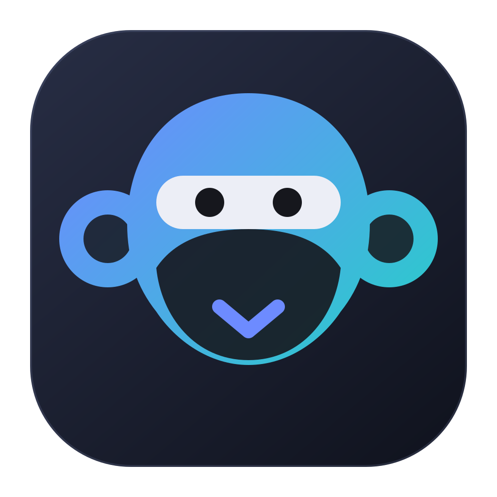
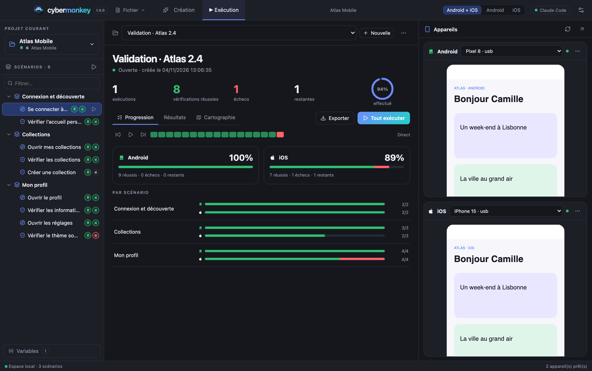
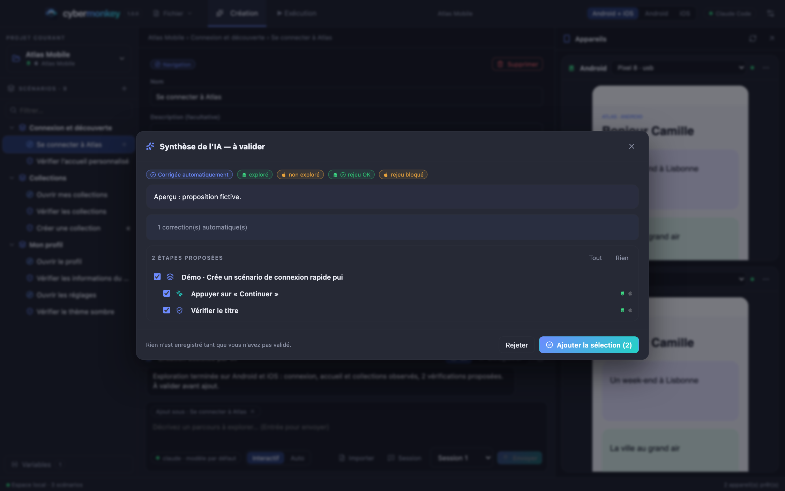
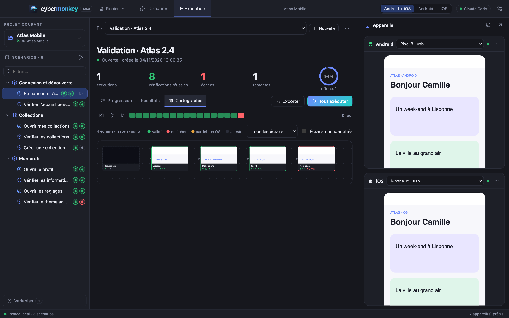

<div align="center">
  
  <h1>Cybermonkey</h1>
  <p><strong>Your mobile tests. With proof built in.</strong></p>
  <p>An open-source desktop workspace to create, record and replay Android &amp; iOS test scenarios — with AI.</p>
  <p><a href="README.fr.md">Français</a> · <strong>English</strong></p>
  <p>
    <a href="https://pickywawa.github.io/cybermonkey/">Website</a> ·
    <a href="https://github.com/pickywawa/cybermonkey/releases/latest">Download</a> ·
    <a href="https://pickywawa.github.io/cybermonkey/fonctionnement.html">How it works</a> ·
    <a href="https://pickywawa.github.io/cybermonkey/fonctionnalites.html">Features</a> ·
    <a href="https://pickywawa.github.io/cybermonkey/aide.html">Help</a> ·
    <a href="CHANGELOG.md">What’s new</a>
  </p>
  <p>
    <a href="https://github.com/pickywawa/cybermonkey/releases/latest"></a>
    <a href="https://github.com/pickywawa/cybermonkey/actions/workflows/ci.yml"></a>
    <a href="LICENSE"></a>
  </p>
</div>



_Screenshots use demonstration data (fictional app “Atlas Mobile”)._

## What you can do

| Create | Run | Understand |
| --- | --- | --- |
| **Describe a journey**: Claude Code, Codex or GitHub Copilot explore your real devices; you review the synthesis before anything is saved. | **Campaigns** per OS with a screenshot per step, fast screen-change detection, **selector self-repair** and **structured failure analysis**. | **Progress** per OS and scenario, a **screen map** of planned vs. tested screens, a replayable timeline. |
| **Record on the phone**: use the app by hand, steps are inferred (ambiguous taps settled by the AI). | Work on **both OS or one at a time**; OS-specific steps are “not applicable” elsewhere, gaps never fail a run. | Reports in **text, CSV, Markdown, Confluence, HTML, JUnit XML, JSON**. |
| **Build by hand**: click components on the live mirror. | **Interactive or auto-approve** exploration, project **variables** (created on the fly by the AI). | Device **diagnostics** with exact fixes and an AI diagnosis. |
| **Import test cases** from Squash TM, TestRail, Azure Test Plans, Gherkin, CSV, JSON, Markdown. | **Web views** the accessibility tree cannot read are driven through a labeled grid on the screenshot. | Detachable **Devices** and **AI** windows, automatic updates, 7 themes, French &amp; English. |

<p align="center">
  
  
</p>

## Built to last

Mobile tests fail for reasons that are not bugs. Cybermonkey is built so that **a failure means something**.

| | |
| --- | --- |
| **Rich steps** | Tap, **long press**, **double tap**, swipe, **scroll until a component is visible**, launch / relaunch / close / background the app, **deep links**, **answer system dialogs**, orientation, keyboard, **capture a text into a variable**. Checks: visible, absent, text, contains, enabled, selected, **regular expression**, **component count**. |
| **Scenario logic** | **Conditions** (“if the cookie banner is visible, close it”, skipped — not failed — otherwise), **sub-scenario calls** (write “Log in” once), **datasets** (one pass per table row, columns are variables), **value capture** reused in later steps. |
| **Environments** | Staging, pre-prod… each with its own variables overriding the common ones; one selector switches creation, runs and MCP. |
| **Interruptions** | Popups, toasts, *session expired* messages, the login screen after a logout, permission dialogs, crashes. When a step fails, the app is relaunched if it vanished, system dialogs are answered (never a button that deletes, logs out or pays), your **interruption handlers** (ordinary scenarios triggered by what is on screen, chainable, able to log in again and **go back to where the test was**) run, and as a last resort the AI closes an unexpected popup. Everything is traced in the report. |
| **Reliability** | **Targeted retry** (a step passing only on the 2nd attempt is marked **unstable**, not hidden), lost-tap protection after a relaunch, **stability history** (“passed 8 of 10” — regression or fragile test?), **selector durability audit** with the identifier to ask developers for, **AI selector repairs** applied to the scenarios in one click. |
| **Diagnostics** | **Video** of failing scenarios only, **device log** around the failure, **network-trouble detection** (offline, timeout, TLS, 5xx, 401/403), **visual comparison** with the last pass (changed areas outlined). |
| **Speed** | Android and iOS driven **in parallel**, condition-based waits, **deep-link shortcut** to a start screen, per-step **duration profile** (acting vs. gathering evidence). |

Details: [Features](https://pickywawa.github.io/cybermonkey/fonctionnalites.html).

## MCP server

Cybermonkey embeds an **MCP server** with **45 tools** (on by default, local only, token-protected, fully switchable in *Settings → MCP*; every tool can be toggled within its group). A calling AI can list scenarios, find the navigation path to a step, move the app to a screen, replay any item in any order, read structured results (failing step, screenshot, analysis), explore and click on the devices, and create + verify new scenarios, on both OS at once. See [docs/mcp.md](docs/mcp.md).

```sh
claude mcp add --transport http cybermonkey http://127.0.0.1:4750/mcp --header "Authorization: Bearer <token>"
```

## Download

**[Cybermonkey 1.1.0 for macOS Apple Silicon](https://github.com/pickywawa/cybermonkey/releases/latest)** — open the DMG and drag Cybermonkey into Applications. The app is locally ad-hoc signed (no Apple notarization): allow it in **System Settings → Privacy &amp; Security → Open Anyway** on first launch. Windows, Linux and Intel builds can be produced from source. Built-in updates detect later stable releases.

## Device setup

| Target | Requirements |
| --- | --- |
| Android | Android Platform Tools (`adb`), a JDK, USB debugging; emulators work too. |
| iOS | macOS + Xcode. Simulators need no signing; physical iPhones need Developer Mode, a Team ID and a WebDriverAgent bundle id. |

Appium, UiAutomator2 and XCUITest are bundled. Open a device’s **Diagnostics** to see what is missing and how to fix it. Full guide: [Help](https://pickywawa.github.io/cybermonkey/aide.html).

## Data and AI

Projects, variables, captures and results stay on your machine. The selected AI provider receives the relevant request and UI context using **your own** account; no Cybermonkey account exists. Variables are **not** an encrypted vault: scenarios store `${NAME}` placeholders, values live in the project folder.

## Development

Node.js **22.12+**.

```sh
git clone https://github.com/pickywawa/cybermonkey.git
cd cybermonkey
npm ci
npm run dev
```

| Command | Purpose |
| --- | --- |
| `npm run dev` | Vite + TypeScript watch + Electron with automatic backend restart. |
| `npm run dev:web` | Browser preview with demo data (no devices, no real AI). |
| `npm run typecheck && npm test` | Types and unit tests. |
| `npm run build` | Production build. |
| `npm run dist -- --mac dmg --arm64` | macOS installer. |
| `npm run site` | Regenerate the website in `site/`. |

Use `CYBERMONKEY_USER_DATA=/absolute/path npm run dev` for an isolated profile. Architecture and how to add a feature: [docs/architecture.md](docs/architecture.md).

## Migrating from Cyberfox

**File → Import a Cyberfox project…** keeps scenarios, campaigns and captures. Flutter projects become Android + iOS.

MIT · © 2026 pickywawa
